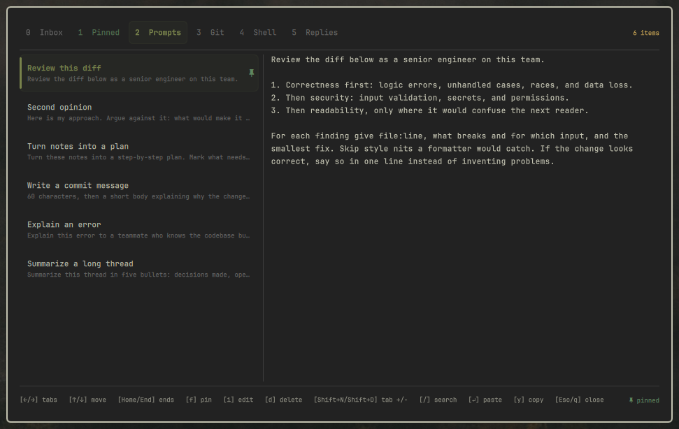

# Snip

A keyboard-first Omarchy picker for saved snippets and clipboard history.



## Install and pick a shortcut

Requires **Omarchy 4** (tested against `4.0.0.alpha`). Keep the built-in `omarchy.clipboard` plugin enabled: it records the history that feeds Snip's Inbox. The other requirements ship with Omarchy.

```sh
omarchy plugin add https://github.com/TheMaxCoder/omarchy-snip --enable
```

Snip doesn't assign a global shortcut. **`SUPER + CTRL + V` is recommended** if you want Snip to replace the stock clipboard panel on that key. Add this to `~/.config/hypr/bindings.lua`; it replaces the binding, **not** the clipboard plugin:

```lua
o.rebind("SUPER + CTRL + V", "Snip", { panel = "themaxcoder.snip" })
```

To keep the stock panel on `SUPER + CTRL + V`, leave that binding alone and use an available shortcut instead, for example:

```lua
o.bind("SUPER + ALT + V", "Snip", { panel = "themaxcoder.snip" })
```

Optional CLI shortcut (with `~/.local/bin` on your `PATH`):

```sh
ln -s ~/.config/omarchy/plugins/themaxcoder.snip/bin/snip ~/.local/bin/snip
```

## Default keys

<!-- Defaults from config.example.json -->
| Action | Keys |
| --- | --- |
| Move up | `Up`, `k` |
| Move down | `Down`, `j` |
| Previous tab | `Left`, `h`, `Shift+Tab` |
| Next tab | `Right`, `l`, `Tab` |
| First item | `Home`, `g` |
| Last item | `End`, `Shift+G` |
| Paste | `Return`, `Enter`, `p` |
| Copy | `y`, `Ctrl+C`, `Super+C` |
| Pin or unpin | `f` |
| Save Inbox item to a tab | `s` |
| Edit a saved text snippet (save Inbox items first) | `i` |
| Delete item | `d` |
| New tab | `Shift+N` |
| Delete tab | `Shift+D` |
| Search | `/` |
| Back | `Escape` |
| Close | `q` |

Digits `0`–`9` jump to tabs outside the save and new-tab dialogs. Press `/` for ranked search across saved snippets and the Inbox. Search treats letters as query text; use the arrows to move, `Enter` to paste, and `Ctrl+C` or `Super+C` to copy. `Escape` clears the query, then returns to navigation, then closes.

## Configuration and editing

Create `${XDG_CONFIG_HOME:-~/.config}/snip/config.json` using [the example and defaults](config.example.json). Set `"startInSearch": true` to start in search mode. Each `keys` override replaces that action's list; `[]` disables it, except that `Return`/`Enter` and `Escape` remain reserved in text inputs. See `snip config --help` for key syntax and `snip config` for effective settings and warnings.

Press `i` on a text snippet in one of your tabs; Inbox items must be saved with `s` first, and the footer shows `edit` only when it applies. Snip uses your `terminal` argv array if set, otherwise `xdg-terminal-exec` opens a floating terminal. It selects the first available editor from `editor` in the config, `$VISUAL`, `$EDITOR`, `nvim`, `vim`, and `nano`. The first line is the title; the rest is the body.

## Capture, import, and export

```sh
snip add                                      # clipboard text → Pinned
snip add --primary --category Work --notify    # primary selection → Work
printf '%s\n' 'Reusable text' | snip add --stdin --title 'My snippet'
snip export --output snip-backup.json
snip export --format markdown --output snippets
snip import snip-backup.json                   # or a .md file or directory
```

`--stdin` removes one trailing newline. Without `--category`, capture pins the item without a tab; otherwise `--pin` is optional. To capture a selection from a key, add this to `bindings.lua` (using a free combination and `snip` on `PATH`):

```lua
o.bind("SUPER + CTRL + SHIFT + V", "Save selection to Snip", "snip add --primary --notify")
```

JSON exports go to stdout by default and reference images by path; they don't embed them. Use `--skip-images` to omit image entries or back up the image files separately. Markdown is text-only, one file per tab plus `Pinned.md` for uncategorized items. Imports skip duplicate content. Run `snip --help` for commands or `snip doctor` to check your setup.

## Data and privacy

- Config: `${XDG_CONFIG_HOME:-~/.config}/snip/config.json`.
- Saved snippets and images: `${XDG_DATA_HOME:-~/.local/share}/snip/` (`snip.db` and `images/`).
- Inbox history: `~/.local/state/omarchy/clipboard-history.json`, managed by Omarchy.

Snip stores text in plaintext SQLite and sends nothing over the network. Omarchy does not record clipboard entries marked sensitive in its history; avoid manually capturing secrets or exporting them.

## Update or uninstall

```sh
omarchy plugin update themaxcoder.snip
omarchy plugin remove themaxcoder.snip
```

On uninstall, remove the Snip binding and optional CLI symlink if you added them. Removing the replacement binding restores the stock binding on reload if Omarchy's defaults are enabled. To permanently delete saved snippets and images, delete the Snip data directory listed above (back it up first if needed); you can also remove the Snip config file. This does not remove Omarchy's clipboard history.

[MIT license](LICENSE).
